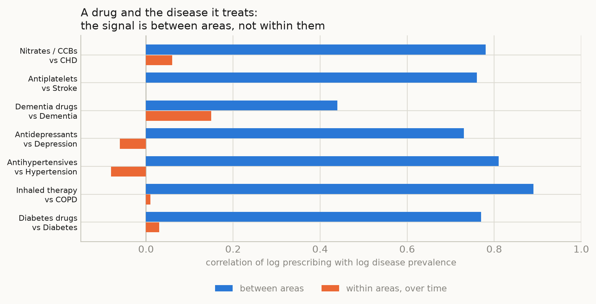

## Abstract

**Background.** England publishes prescribing for every general practice and disease statistics
for every local authority and practice. Linking them is an obvious way to look for effects of
medicines on disease, and such analyses are increasingly easy to run. We asked what an unguided
scan of these data actually produces, and whether any of it can be believed.

**Methods.** We linked 194 BNF sections of primary care prescribing to every disease outcome
published for the same unit, at three levels: 151 upper-tier local authorities, 294 lower-tier
authorities, and about 6,200 general practices followed for up to 16 years. Each drug-outcome
pair was estimated twice with unit and year fixed effects: once with prescribing in the year
before the outcome, and once with prescribing in the year after. Because shared local trends
produce both, the second scan is an empirical null. We added positive controls pairing each drug
with the disease it is prescribed for, and we report a worked example, immunosuppressant
medicines and tuberculosis, analysed in the conventional hypothesis-driven way with a
disease-specific positive control, negative-control exposures, minimum detectable effects and a
power simulation.

**Results.** At area level the scan produced associations for 19% of pairs, but prescribing in
the year *after* the outcome produced as many (19%), with identical inflation. The positive
controls failed entirely: within areas over time, diabetes prescribing was unrelated to diabetes
prevalence (r = 0.03) although between areas the two were nearly interchangeable (rho = 0.77).
At practice level the positive controls succeeded, every one strongly, but the association with
prescribing in the following year was larger than with the preceding year in 56% of pairs and in
every indication pair, and 45-50% of all pairs reached significance. Filtering on
before-beats-after left candidates such as stoma bags and catheters against endoscopy and cancer
screening, and the single strongest signal in the scan was patient satisfaction with the
practice. In the tuberculosis example, no medicine was associated with later notifications, the
smallest detectable effect was 11 to 272 times the effect expected from published relative risks,
and a simulation detected the established glucocorticoid effect no more often than no effect at
all.

**Conclusions.** Open English prescribing and disease data cannot support inference about effects
of medicines on disease. At area level the necessary adjustment removes the only variation that
carries information; at practice level variation survives but what it measures is diagnosis
driving prescribing, and ascertainment, rather than drugs causing disease. Analyses of these data
should report an empirical null and a positive control, without which large numbers of confident
and entirely spurious findings are guaranteed.

## Introduction

England publishes an unusual amount of health data openly. Every item dispensed from every
general practice appears monthly in the English Prescribing Dataset; disease registers, mortality,
hospital admissions and screening uptake are published for local authorities and for practices.
The datasets share identifiers, cover the whole country and are free. Linking prescribing to
disease is therefore within reach of anyone with a laptop, and the apparent promise is obvious:
population-scale signals about the effects of medicines, at no cost and with no consent problem.

The statistical hazards of such ecological analyses are long established. Associations between
areas need not hold within them; adjustment at area level cannot remove bias arising from
differences between people within areas; and power depends mainly on the number of units, which
is fixed. What is less often examined is what these particular data do when a researcher simply
looks, and whether the standard precautions are enough to tell a real finding from an artefact.

We approached the question from two directions. First, we ran the analysis that an enthusiastic
analyst might run: every drug group against every available disease outcome, at three different
units of analysis, with no hypothesis specified in advance. Second, we carried out the opposite
exercise on a single question chosen for its clinical plausibility, the effect of
immunosuppressant medicines on tuberculosis, with the full apparatus of pre-specification, a
disease-specific positive control, negative-control exposures, falsification tests, minimum
detectable effects and a power simulation.

The two approaches converge. We report both, and the diagnostics that distinguish a real
association from the very large number of convincing-looking false ones these data generate.

## Methods

### Data

**Prescribing.** NHS Business Services Authority English Prescribing Dataset, January 2014 to
December 2024, aggregated with server-side SQL to practice by month by BNF section, giving 194
sections covering all prescribing. We restricted to standard general practices: those with NHS
Organisation Data Service prescribing setting RO76, plus codes absent from the current ODS file,
which omits practices closed before 2017, that have the standard practice code format. Without
that addition, prescribing by practices that later closed is dropped unevenly over time.

**Outcomes.** Every indicator published in OHID Fingertips for the relevant unit with counts and
denominators: 661 at upper-tier and 436 at lower-tier local authority level, and 197 at practice
level. For each indicator we kept one headline series (Persons, no inequality breakdown, the age
group with the most unit-years), mapped financial years to calendar years and excluded pooled
multi-year periods. Indicators with fewer than six single years of counts and denominators were
dropped, leaving 211 outcomes at upper-tier level and 106 at practice level.

**Units of analysis.** Three: 151 upper-tier local authorities, 294 lower-tier authorities, and
about 6,200 general practices. At area level prescribing was apportioned to areas in proportion to
where each practice's registered patients lived, using NHS Digital practice by LSOA registration
counts, since practices do not sit where their patients live. At practice level no apportionment
is needed, because exposure and outcome are measured on the same unit.

### What these data are, and are not

Every figure used here is an aggregate count published openly. For prescribing, the unit is a
practice-month: the number of items dispensed in a BNF section, with no patient identifiers and
no link between a prescription and the person who received it. For outcomes, the unit is a
practice-year or area-year: the size of a disease register, or a count of deaths, admissions or
screening tests. Nothing in this study links an individual's prescription to their own diagnosis,
and nothing identifies an individual prescriber.

"Prescribing in the year before the outcome" therefore means that the practice's total prescribing
in one calendar year is compared with its recorded disease count in the next, across practices.
It does not mean that a drug was given to a patient before that patient was diagnosed. This
distinction matters for interpretation: an aggregate temporal ordering of this kind is a weak
instrument for causal direction, which is precisely why we treat the reverse ordering as a null
rather than reading the forward one as an effect.

A related limitation applies to the outcomes. Disease registers depend on practices recording and
coding diagnoses, which is incentivised by the Quality and Outcomes Framework but varies between
practices and over time. Register counts are therefore a measure of recorded disease, not of
disease, and the difference is itself correlated with how actively a practice does everything
else, including prescribing.

### The scan

For every drug-outcome pair we fitted

    log(outcome rate) = beta * log(prescribing rate) + unit effect + year effect

with unit and year fixed effects swept out by alternating projections and standard errors
clustered by unit. Exposure was items per 1,000 residents at area level and items per 1,000
registered patients at practice level. At practice level many section-years are genuinely zero,
so a continuity correction was applied and sections prescribed by fewer than 80% of practice-years
were dropped. Estimating all sections for one outcome as a single matrix operation makes the full
scan minutes rather than hours.

### Calibration

A scan of this size will produce many associations whatever is true, so the design carries three
internal standards.

**An empirical null.** Every pair was estimated twice: with prescribing in the year *before* the
outcome, and with prescribing in the year *after*. A drug effect can only act forwards. Shared
local trends, changes in coding, and the drift of a practice or area over time act on both.
The distribution of results from the second scan is therefore what the first must beat, and we
summarise the excess with an inflation factor, the median squared z statistic divided by its
expectation under the null, which is 1 when nothing is going on.

**Positive controls.** Each drug group was paired with the disease it is prescribed for: diabetes
drugs with the diabetes register, inhaled therapy with COPD, antiepileptics with epilepsy, and so
on. Whatever the direction of causation, these must show associations. If they do not, the design
cannot detect anything and nothing else in the scan is interpretable.

**Where the variation lives.** For the same pairs we compared the correlation between units, using
unit means, with the correlation within units over time, after removing unit and year means. This
shows directly how much information the fixed effects remove.

### Worked example: immunosuppressants and tuberculosis

As a contrast to the unguided scan we report a conventional analysis of one clinically plausible
question. Systemic glucocorticoids, inhaled corticosteroids, DMARDs and transplant
immunosuppressants in primary care, and TNF inhibitors, interleukin-6 inhibitors, JAK inhibitors,
rituximab and other agents issued by NHS trusts, were related to UK Health Security Agency
tuberculosis notifications for 2014 to 2024. That analysis used Poisson models with the same fixed
effects, prescribing in the preceding year, a disease-specific positive control (hospital
treatment for active tuberculosis, measured as pyrazinamide defined daily doses), negative-control
exposures, falsification tests, minimum detectable effects compared against effects expected from
published individual-level relative risks and from national records of drug-associated
tuberculosis, and a permutation power simulation on the real notification counts. Full detail is
given in the supplement.

Analyses used Python 3.14 with pandas, NumPy, SciPy and statsmodels. All data are public and the
code and processed datasets are openly available.

## Results

### What the scan produces

The scan covered 32,608 drug-outcome pairs at upper-tier level, 20,112 at lower-tier level and
12,296 at practice level, each estimated twice (table 1).

**Table 1.** Results of the scan at each unit of analysis, with prescribing measured before and after the outcome.

| unit | exposure | pairs | pct_significant | median_abs_z | inflation_lambda |
|:---|---:|---:|---:|---:|---:|
| Upper-tier areas (151) | year before | 32608 | 18.8 | 0.97 | 2.1 |
| Upper-tier areas (151) | year after | 32527 | 19.2 | 0.99 | 2.2 |
| Lower-tier areas (294) | year before | 20112 | 21.6 | 1.03 | 2.3 |
| Lower-tier areas (294) | year after | 19624 | 21.2 | 1.03 | 2.3 |
| GP practices (~6,200) | year before | 12296 | 44.9 | 1.71 | 6.4 |
| GP practices (~6,200) | year after | 10788 | 49.7 | 1.94 | 8.3 |

At area level, 18.8% of pairs reached conventional significance with prescribing in the year
before the outcome. Prescribing in the year *after* the outcome produced 19.2%. The inflation
factor was 2.1 for both. Lower-tier authorities gave 21.6% and 21.2%, inflation 2.3 for both. On
a quantile plot the two distributions lie on top of one another (figure 2, left), both at roughly
twice the null. Taken at face value the lag scan yields 1,885 associations surviving false
discovery rate correction; the nonsense control yields 2,074.

### Why: the fixed effects remove the signal

The positive controls explain this. Within areas over time, prescribing of a drug was unrelated
to the prevalence of the disease it treats: diabetes drugs against the diabetes register r = 0.03,
inhaled therapy against COPD r = 0.01, antihypertensives against hypertension r = -0.08,
antiplatelets against stroke r = -0.00. Between areas the same pairs correlate at 0.73 to 0.89
(figure 1, table 2).

**Figure 1.** Correlation between prescribing of a drug and the prevalence of the disease it treats, upper-tier local authorities. Between areas the two are nearly interchangeable; within areas over time the relationship is absent.

**Table 2.** Drug against its own indication: correlation between areas and within areas over time.

| drug | outcome | between_areas | within_areas |
|:---|---:|---:|---:|
| Diabetes drugs | Diabetes | 0.77 | 0.03 |
| Inhaled therapy | COPD | 0.89 | 0.01 |
| Antihypertensives | Hypertension | 0.81 | -0.08 |
| Antidepressants | Depression | 0.73 | -0.06 |
| Dementia drugs | Dementia | 0.44 | 0.15 |
| Antiplatelets | Stroke | 0.76 | -0.0 |
| Nitrates / CCBs | CHD | 0.78 | 0.06 |

Almost all the information in these data is cross-sectional. Area and year fixed effects, which
are needed to deal with the obvious confounding by population composition and deprivation, remove
it. What remains is too small to carry even the strongest relationship in the data, that between a
drug and its own indication, and the associations that survive are not distinguishable from those
of an impossible exposure.

### Practices: sensitivity, but the signal runs backwards

Moving to practices increases the units from 151 to about 6,200 and the period from 11 years to
16. Here the positive controls succeed, and strongly: diabetes drugs against the diabetes register
z = 6.5, inhaled therapy against COPD z = 7.3, antiepileptics against epilepsy z = 10.6, dementia
drugs against dementia z = 16.0 (table 3). The design can detect relationships when they exist.

**Table 3.** Positive controls at area and practice level (z statistics).

| level | drug | outcome | z_year_before | z_year_after |
|:---|---:|---:|---:|---:|
| areas | Diabetes drugs | Diabetes | -0.1 | 0.2 |
| areas | Inhaled therapy | COPD | 0.1 | 0.3 |
| areas | Antihypertensives | Hypertension | -1.0 | -0.6 |
| areas | Antidepressants | Depression | -0.5 | -1.0 |
| areas | Dementia drugs | Dementia | 1.3 | 2.5 |
| areas | Antiplatelets | Stroke | 0.1 | -0.4 |
| areas | Nitrates / CCBs | CHD | 0.6 | 0.9 |
| practices | Diabetes drugs | Diabetes | 6.5 | 7.1 |
| practices | Inhaled therapy | COPD | 7.3 | 7.8 |
| practices | Antihypertensives | Hypertension | 7.3 | 7.9 |
| practices | Antidepressants | Depression | 4.9 | 4.4 |
| practices | Dementia drugs | Dementia | 16.0 | 25.7 |
| practices | Antiplatelets | Stroke | 9.0 | 9.6 |
| practices | Antiepileptics | Epilepsy | 10.6 | 11.9 |
| practices | Nitrates / CCBs | CHD | 8.2 | 9.9 |

Two features undermine it. First, in every indication pair the association with prescribing in the
*following* year was larger than with the preceding year, decisively so for dementia (z = 25.7
against 16.0). This is the expected direction if diagnosis drives prescribing, and it means the
temporal ordering in these data points the opposite way to a drug effect. Second, 44.9% of all
pairs were significant with the preceding year and 49.7% with the following year, inflation 6.4
and 8.3 (figure 2, right); practices that grow, merge or improve their coding do more of
everything at once.

**Figure 2.** Observed against expected |z| for every drug-outcome pair. Blue: prescribing in the year before the outcome. Orange: prescribing in the year after, which cannot be a cause and so serves as an empirical null. Left, upper-tier areas: the two are indistinguishable. Right, GP practices: both are inflated and the year-after curve is higher.

We checked whether the inflation was an artefact of a shared denominator, since both exposure and
outcome are expressed per registered patient and list sizes are known to be inflated. It is not:
adding log list size as a covariate moved the diabetes positive control from z = 9.9 to 9.8, and
models using numerators with list size as a covariate agreed.

### The candidates that survive filtering

Restricting to pairs where the preceding year beats the following year, which is where a genuine
drug effect would sit, does not produce a plausible shortlist. The strongest such signal in the
entire scan was patient satisfaction with the practice, apparently produced by ear preparations,
antifungals and vaccines (table 4). Restricted to disease outcomes, the leading candidates were
peak flow meters against chronic kidney disease, night drainage bags and leg bags against bowel
cancer screening coverage, and gluten-free foods against cancer referral conversion (table 5).
These are markers of how sick and how intensively managed a practice's population is.

**Table 4.** Strongest candidates in the whole scan after requiring the year-before association to beat the year-after one.

| outcome | BNF section | what is in it | z (year before) | z (year after) |
|:---|---:|---:|---:|---:|
| % who have a positive experience of their GP practice | 1201 | Hydrocortisone acetate,Oils for the ear,Betame | 15.0 | 3.0 |
| % who have a positive experience of their GP practice | 1103 | Ciprofloxacin,Hydrocort sodiumphos,Ofloxacin,C | 16.0 | 6.1 |
| % who have a positive experience of their GP practice | 1307 | Camellia sinensis extract,Formaldehyde,Imiquim | 9.8 | 0.0 |
| % who have a positive experience of their GP practice | 1404 | Hepatitis B,Influenza,Hepatitis A/typhoid vacc | 8.6 | -0.1 |
| % who have a positive experience of their GP practice | 502 | Ketoconazole,Voriconazole,Fluconazole,Terbinaf | 14.8 | 6.5 |
| % who have a positive experience of their GP practice | 1203 | Chlorhexidine gluconate,Amylmetacresol,Pilocar | 9.2 | 1.1 |
| % who have a positive experience of their GP practice | 1310 | Gentamicin sulfate,Mupirocin,Sodium fusidate,B | 12.5 | 4.5 |
| % who have a positive experience of their GP practice | 1502 | Lidocaine hydrochloride,Levobupivacaine hydroc | 9.2 | 1.9 |

**Table 5.** The same filter restricted to disease outcomes.

| outcome | BNF section | what is in it | z (year before) | z (year after) |
|:---|---:|---:|---:|---:|
| CKD: QOF prevalence | 2112 | Peak Flow Meters | 8.4 | 3.2 |
| % reporting cancer in the last 5 years | 1001 | Colchicine,Nabumetone,Ibuprofen lysine,Diclofe | 5.9 | 0.9 |
| % reporting cancer in the last 5 years | 604 | Raloxifene hydrochloride,Progesterone,Dutaster | 8.2 | 3.5 |
| Depression: QOF incidence - new diagnosis | 702 | Boric acid,Clotrimazole,Miconazole nitrate,Met | -4.7 | -0.3 |
| Bowel cancer screening coverage: aged 60 to 74 years old | 2260 | Night Drainage Bags | 4.1 | 0.0 |
| Bowel cancer screening coverage: aged 60 to 74 years old | 2250 | Leg Bags | 4.2 | 0.1 |
| Urgent suspected cancer referrals resulting in a diagnosis of cancer (Conversion rate: as % of all USC referrals) | 904 | Low protein breads,Gluten free/low protein pas | -5.3 | 1.6 |
| Depression: QOF incidence - new diagnosis | 1303 | Mepyramine maleate,Benzocaine,Crotamiton,Menth | -6.3 | -2.6 |

### Robustness: lag length, case-mix and stricter thresholds

Three objections to the above can be tested directly.

**A single one-year lag may be too short.** An effect of prescribing on disease may take several
years to appear, which would make a one-year lag the wrong place to look. Repeating the practice
scan at lags of one, two and three years, with the matching leads, does not change the
conclusion. Inflation falls as the interval lengthens (lambda 6.4, 4.5, 3.4 at lags of one, two
and three years) but the lead is at least as inflated as the lag at every matched distance (6.8,
5.9, 5.0). Longer lags attenuate everything rather than revealing anything, and the backwards
asymmetry widens rather than closes.

**The surviving associations may mark sicker, more intensively managed practices.** Adding the
practice's total prescribing volume per patient, a time-varying proxy for case-mix and activity,
reduces the inflation but does not remove it (lambda 6.4 to 4.3 at lag one; 46% of pairs
significant falls to 36%). Nor does it dispose of the odd candidates: peak flow meters against
chronic kidney disease moves from z = 8.4 to 7.2, upper GI endoscopy against ostomy systems from
3.9 to 3.1, while leg bags against bowel cancer screening coverage moves the wrong way, from 4.2
to 5.0.

**A stricter significance threshold may be the answer.** It is not, and this is the most
important of the three. Of 12,296 pairs at lag one, 5,524 reach p < 0.05, 4,688 survive false
discovery rate correction, and 1,869 survive a Bonferroni threshold of p < 4.1 x 10^-6. Fifteen
per cent of all drug-outcome pairs in the scan pass the strictest correction in common use. This
is what distinguishes a bias problem from a multiplicity problem: multiplicity corrections
control the error rate when the null distribution is correct, and here it is not. The empirical
null, not the threshold, is what reveals the difficulty.

### Worked example: immunosuppressants and tuberculosis

The hypothesis-driven analysis reached the same place by a different route. No medicine was
associated with notifications in the following year after correction for multiple testing;
systemic oral glucocorticoids gave an incidence rate ratio of 0.969 (95% CI 0.929 to 1.012) per
10% within-area increase. The negative-control exposure, levothyroxine, was inversely associated
to the same degree as metformin, and prescribing in the following year predicted fewer
notifications for several drug groups.

The quantitative version of the problem is stark. For oral glucocorticoids the smallest detectable
effect was 6.3% per 10% increase in prescribing, against 0.34% expected from published relative
risks and prevalence of use, and 0.04 to 0.09% implied by national records of steroid-associated
tuberculosis: a gap of 18 to 140 times. Across drug groups the gap ranged from 11 to 272 times. In
a simulation that preserved the real notification counts, the established glucocorticoid effect
was detected in 8.3% of replicates against 7.8% when there was no effect at all.

The one element that did work was the disease-specific positive control. Hospital treatment for
active tuberculosis tracked notifications between areas (Spearman rho 0.81) and within areas in
the same year (1.035, 1.009 to 1.061 per 10% increase). Even that, a drug used almost exclusively
for the outcome, was recovered with an elasticity of only 0.36 to 0.40.

## Discussion

An unguided scan of English prescribing against disease produced thousands of associations at
every level of analysis we tried, and essentially none of them can be believed. The reason differs
by level, and both reasons are instructive.

At area level the problem is that there is nothing left to see. The relationship between a drug
and the disease it treats, which should be the easiest signal in these data, is almost
deterministic between areas and absent within them. Fixed effects are not an optional refinement
here: without them, prescribing is a proxy for the age, deprivation and morbidity of a population
and every association is confounded. With them, the remaining variation is too small to carry
anything. Power in aggregate studies depends mainly on the number of units, and 151 or 294 is not
many.

At practice level the data do carry signal, which was the encouraging finding, but the signal is
pointing the wrong way. Every indication pair showed a stronger association with prescribing in
the year after the outcome than the year before. That is what reverse causation looks like:
practices diagnose, then prescribe. The pervasive inflation on top of it, with roughly half of all
pairs significant, reflects practices drifting together in coding, list composition and activity.
Both effects are strongest for exactly the outcomes drawn from the practice's own records, though
the pattern persisted for externally recorded outcomes such as admissions and screening.

The tuberculosis example shows that the problem is not solved by doing the conventional thing
carefully. That analysis was pre-specified in part, used a disease-specific positive control,
negative-control exposures, falsification tests and a power simulation, and still could only have
detected effects one to several hundred times larger than any that plausibly exist. The positive
control there is instructive in a different way: a drug given almost exclusively to people with
the outcome was recovered with an elasticity of 0.36, so even a perfect exposure is heavily
attenuated by the way these data are assembled.

A natural response to a scan of this size is to demand a stricter threshold. That response fails
here: 1,869 pairs survive Bonferroni correction. Multiplicity corrections assume the null
distribution is right, and the whole difficulty is that it is not. Nor is the problem solved by
looking further back in time, or by adjusting for how sick and active a practice is; both reduce
the inflation without removing it or changing the direction of the asymmetry.

**What follows for practice.** We would not argue that ecological analyses of open prescribing
data are never worth doing; they are excellent for describing prescribing and its variation. But
an analysis that relates prescribing to disease should report, alongside any association:

- an empirical null, most simply the same analysis with the exposure measured after the outcome;
- a positive control, a drug paired with its own indication, demonstrating the design can detect
  something;
- where the variation lies, between units and within them, since fixed effects may have removed
  all of it;
- the smallest effect the design could detect, next to the effect size that is actually plausible.

Had we reported only our primary estimates, this work would have yielded roughly 2,000
false-discovery-rate-significant findings at area level and several thousand at practice level,
any of which could have been written up with a mechanism attached. The diagnostics are what
separate those from nothing, and they are cheap.

**Limitations.** The outcomes are those published in Fingertips, which are weighted towards
registers, mortality and service measures rather than incident disease; only a minority are
recorded outside the practice. Exposure is prescribing volume, not people treated, and additional
volume may lengthen existing courses rather than reach new patients. Our scan used a single
one-year lag; effects with longer or shorter latency would be missed, though the positive controls
suggest the limitation is not timing. The practice panel is unbalanced because practices merge and
close. Finally, this is an ecological analysis throughout and its conclusions concern what these
data can support, not whether any particular medicine affects any particular disease.

## Conclusions

Open English prescribing and disease data cannot support inference about the effects of medicines
on disease. At area level the adjustment required to make the comparison fair removes the
information needed to make it at all. At practice level information survives, but what it measures
is diagnosis driving prescribing, and the drift of practices over time. A scan of 23,000 pairs
produced as many associations running backwards in time as forwards, and its strongest candidate
was patient satisfaction. Analyses of these data that do not report an empirical null and a
positive control should be assumed to be measuring confounding.

## Data and code availability

All inputs are public: NHSBSA English Prescribing Dataset, OHID Fingertips, NHS Digital practice registration counts and NHS England Organisation Data Service. Code, processed datasets, the full scan results and the tuberculosis supplement are at https://github.com/drcjar/tb-prescribing-england
